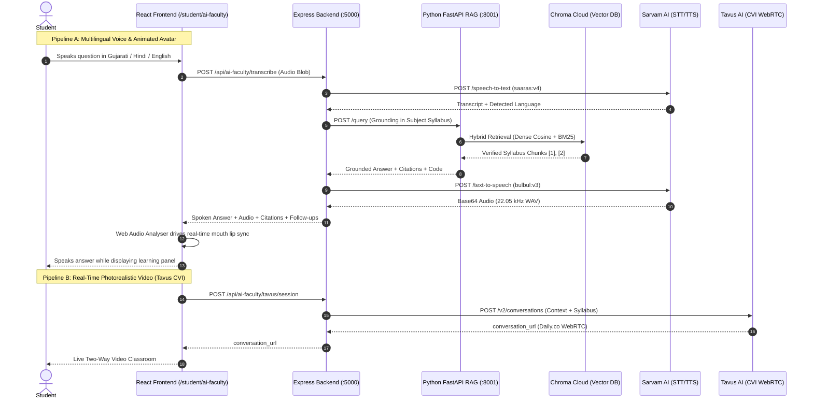

# AI Faculty Module — Setup & Architecture Guide

> **EduSense AI — 1-on-1 Multilingual Voice & Video AI Professor Grounded in CSPIT CSE Syllabus**  
> *Supports Gujarati, Hindi, and Indian English with Real-Time Barge-In Interruption, Lip Synchronization, and Agentic RAG Grounding.*

---

## 1. Architectural Overview

The **AI Faculty module** bridges university students with a realistic, real-time conversational AI teacher. It operates through two complementary media pipelines:



---

## 2. Barge-In & Interruption Engineering

Genuine, low-latency interruption ("barge-in") is enforced via a strict multi-layer protocol:

1. **Continuous Voice Activity Detection (VAD)**:
   * The client's microphone stream runs through an `AudioContext` and `AnalyserNode` (`fftSize = 256`).
   * When student speech energy crosses the threshold during the `SPEAKING` state, interruption triggers immediately.
   * Alternatively, pressing the **"Interrupt Teacher"** button or hitting the **Spacebar** instantly triggers interruption.

2. **Immediate Audio Termination**:
   * Calling `activeAudioSource.stop()` or `audio.pause()` shuts down browser audio output in under 10ms.
   * Mouth opening state snaps back to neutral (`mouthOpenAmount = 0`).

3. **In-Flight Cancellation**:
   * An active `AbortController` instantly terminates in-flight network requests to `/api/ai-faculty/interact` or the RAG service.

4. **Monotonic Turn ID Tokens**:
   * Each query is stamped with an integer `turnId` (e.g. `turn 1`, `turn 2`).
   * Upon interruption, `turnIdRef.current` increments.
   * Any late or out-of-order network responses returning with an obsolete `turnId` are strictly discarded, preventing delayed speech from leaking into subsequent questions.

---

## 3. Provider Evaluation & Compatibility Findings

### A. Sarvam AI (Speech-to-Text & Text-to-Speech)
* **Status**: **Fully Supported & Integrated**
* **Speech-to-Text Model**: `saaras:v4` (`https://api.sarvam.ai/speech-to-text`)
  * Native support for **Gujarati (`gu-IN`)**, **Hindi (`hi-IN`)**, and **English (`en-IN`)**.
  * Handles code-mixed speech (Hinglish, Gujlish) cleanly with `mode: "transcribe"`.
* **Text-to-Speech Model**: `bulbul:v3` (`https://api.sarvam.ai/text-to-speech`)
  * Voices: `anushka` (Academic Female), `shubh` (Analytical Male), `ritu` (Interactive Female), `aditya` (Calm Male).
  * Dynamic pace adjustment (`0.85x` to `1.25x`).
  * Text sanitization ensures code blocks, mathematical LaTeX syntax, and citation brackets (`[1]`, `[2]`) are converted into spoken human language instead of spoken punctuation.
* **Fallback**: Automatic graceful degradation to client-side Web Speech API if API key is not present.

### B. Tavus AI (Conversational Video Interface / CVI)
* **Status**: **Fully Supported via Dual-Mode Switcher**
* **Endpoint**: `POST https://tavusapi.com/v2/conversations`
* **Transport**: Daily.co WebRTC stream rendered securely inside an interactive iframe.
* **Findings**:
  * Tavus CVI controls the live WebRTC stream directly between the client browser and the Phoenix avatar replica.
  * Because Tavus processes audio internally via its own WebRTC pipeline, external raw PCM audio streaming from third-party engines into a Tavus WebRTC call is not supported by Tavus v2.
  * **Solution**: EduSense AI provides a one-click **Dual-Mode Switcher**:
    1. **Sarvam AI Mode**: High-fidelity interactive animated avatar with real-time lip sync, full Gujarati/Hindi/English speech synthesis, and millisecond barge-in.
    2. **Tavus WebRTC Mode**: Photorealistic human video replica streaming directly via Tavus CVI with embedded syllabus context.

---

## 4. Environment Configuration

Add the following variables to your root `.env` file (copied from `.env.example`):

```env
# ------------------------------------------------------------------------------
# 7. AI Faculty Real-Time Voice & Video Services
# ------------------------------------------------------------------------------
# Sarvam AI (Speech-to-Text & Text-to-Speech for Gujarati, Hindi, English)
# Sign up at https://dashboard.sarvam.ai to obtain your subscription key
SARVAM_API_KEY=your_sarvam_api_subscription_key_here

# Tavus AI (Real-time Conversational Video Replica / WebRTC)
# Sign up at https://platform.tavus.io to obtain your API key
TAVUS_API_KEY=your_tavus_api_key_here
TAVUS_REPLICA_ID=r79e1c033f
TAVUS_PERSONA_ID=p9a8b7c6d5
```

---

## 5. How to Obtain API Keys

### 1. Sarvam AI Key
1. Visit [https://dashboard.sarvam.ai](https://dashboard.sarvam.ai) and sign up for a free developer account.
2. Navigate to **API Keys** and generate a new subscription key.
3. Paste the key into `SARVAM_API_KEY` in `.env`.
4. Free tier includes free credits for `saaras:v4` STT and `bulbul:v3` TTS.

### 2. Tavus AI Key
1. Visit [https://platform.tavus.io](https://platform.tavus.io) and create an account.
2. Navigate to **Developer Settings** -> **API Keys** and copy your `x-api-key`.
3. Under **Replicas / Stock Avatars**, choose an academic persona replica and copy its ID (e.g. `r79e1c033f`).
4. Paste into `TAVUS_API_KEY`, `TAVUS_REPLICA_ID`, and `TAVUS_PERSONA_ID` in `.env`.

---

## 6. Running the Application

### Start Express API Gateway
```bash
node server.express.js
```
*Listens on port `5000` with `/api/ai-faculty/*` endpoints mounted.*

### Start Python Agentic RAG Microservice
```bash
cd rag_service
uvicorn app.main:app --port 8001
```

### Start React Frontend
```bash
npm run dev
# or
vite dev
```
*Access the AI Faculty Classroom at: `http://localhost:8080/student/ai-faculty`*

---

## 7. Verification & Automated Testing

Run the automated test suite:
```bash
node --test tests/ai-faculty.test.js
```

### Manual Testing Checklist

| Step | Action | Expected Outcome |
| :--- | :--- | :--- |
| **1. Navigation** | Click "AI Faculty" in the Student sidebar. | Navigates to `/student/ai-faculty` with classroom layout. |
| **2. Session Connect** | Select subject (e.g. Operating Systems) and click "Start Live Session". | State moves `IDLE` → `CONNECTING` → `SPEAKING` (Greeting) → `LISTENING`. |
| **3. Voice Question** | Speak: *"Explain how paging works in virtual memory."* | Audio transcribes, query passes to RAG, teacher speaks answer while mouth syncs. |
| **4. Interruption** | Speak or click "Interrupt Teacher" mid-sentence. | Spoken audio cuts off instantly (<20ms), state shifts to `INTERRUPTING` → `LISTENING`. |
| **5. Gujarati Test** | Switch language to Gujarati (`ગુજરાતી`) and ask a question. | Teacher explains concept in natural Gujarati. |
| **6. Hindi Test** | Switch language to Hindi (`हिंदी`) and ask a question. | Teacher explains concept in natural Hindi. |
| **7. Learning Panel** | Switch between Lesson, Worked Example, and Transcript tabs. | Shows citations (`[1] Unit_3_Memory.pdf`), code block with copy button, and turn history. |
| **8. Tavus Mode** | Switch Avatar Engine to "Tavus WebRTC". | Embeds live WebRTC stream if `TAVUS_API_KEY` is configured. |
