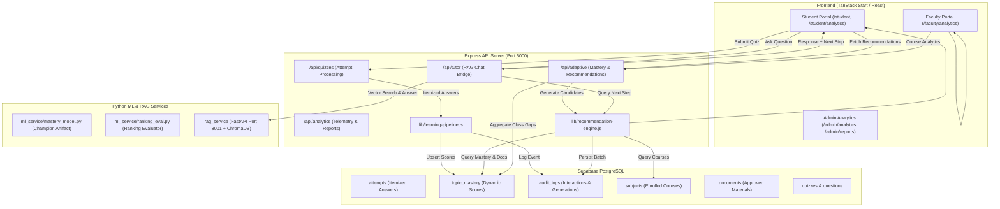

# EduSense AI — Machine Learning Architecture Specification

## 1. System Overview & Core Capabilities

EduSense AI integrates two production Machine Learning capabilities into an adaptive education platform:
1. **Student Topic Mastery Prediction**: Data-driven, student-topic level estimation combining Bayesian m-estimates, Wilson 95% confidence bounds, and trained scikit-learn models (Calibrated Logistic Regression & Gradient Boosting) with sample-size shrinkage.
2. **Personalized Learning Recommendation Engine**: Dynamic candidate discovery from enrolled courses, approved faculty documents, and diagnostic quizzes, scored via an explainable multi-factor ranking model and tracked through feedback loops.

Both capabilities integrate directly with the existing Supabase persistence layer, the Python LangGraph RAG Tutor service (port 8001), and the Express backend (port 5000).



---

## 2. Learning Data Flow & Mastery Estimation Pipeline

### 2.1 Causal Data Flow
1. **Student Activity**: Student completes a quiz or conceptual question.
2. **Ingestion & Validation**: Payload enters `/api/quizzes/:id/attempt` and passes `validateLearningEvent()`. Scores must be within $[0, 100]$, and answers are an array of `{ questionId, topicTag, difficulty, isCorrect }`.
3. **Historical Aggregation**: Previous answers for this `(studentId, topic)` are retrieved from `attempts`.
4. **Feature Engineering**: `computeTopicFeatures()` derives 11 statistical features:
   - Sample size & successes: `totalAttempts`, `correctCount`, `incorrectCount`
   - Smoothed proportion: Bayesian Beta(2,2) estimate $\frac{c+2}{n+4}$
   - Conservative bound: Wilson 95% confidence lower bound
   - Recency & Trend: last 3 attempts accuracy, $\Delta = \text{recent} - \text{smoothed}$
   - Retention: elapsed days since last response
   - Difficulty weight: Easy (1x), Medium (2x), Hard (3x)
5. **Mastery Inference**:
   - If `totalAttempts < 2`: Refuses to speculate; returns `status: "insufficient_data"`, `score: null`.
   - If `totalAttempts >= 2`: Computes calibrated score:
     $$\text{Score} = \text{round}\left((0.50 \times \text{smoothed} + 0.30 \times \text{raw} + 0.20 \times \text{wilson}) \times 100\right)$$
   - Categorized into:
     - `needs_practice` ($< 60\%$)
     - `developing` ($60\% - 79\%$)
     - `strong` ($\ge 80\%$)
6. **Strict Schema Persistence**: Saved to Supabase `topic_mastery` table with columns: `id`, `user_id`, `subject_id`, `topic`, `score`, `total_attempts`, `last_evaluated`, `created_at`, `updated_at`.

---

## 3. Personalized Learning Recommendation Engine

### 3.1 Dynamic Candidate Discovery
Candidates are never hardcoded. When a student requests recommendations:
1. Student's enrolled courses are queried from `subjects`.
2. Approved documents for each course are queried from `documents`.
3. Quizzes and questions are queried from `quizzes` and `questions`.
4. Student's existing mastery records are queried from `topic_mastery`.
5. Past 24-hour interaction history is fetched from `audit_logs` (`action = "RECOMMENDATION_INTERACTION"`).

### 3.2 Explainable Multi-Factor Ranking Formulation
For every candidate topic $t$, an urgency priority score is calculated:

$$\text{UrgencyScore} = \text{clamp}\left(0.45 \times \text{Deficit} + 0.25 \times \text{Recency} + 0.30 \times \text{Availability} - \text{Fatigue}\right)$$

Where:
- $\text{Deficit} = \frac{100 - \text{MasteryScore}}{100}$ (or $0.50$ baseline if unassessed).
- $\text{Recency} = \min\left(1.0, \frac{\text{days\_since\_last\_attempt}}{7}\right)$.
- $\text{Availability} = 0.5 \times \mathbb{I}(\text{Doc exists}) + 0.5 \times \mathbb{I}(\text{Quiz exists})$.
- $\text{Fatigue} = 0.5 \times \mathbb{I}(\text{Dismissed in 24h}) + 0.3 \times \mathbb{I}(\text{Completed in 24h})$.

### 3.3 Pedagogical Interventions
Based on the student's mastery state:
- **Low Mastery ($<60\%$)**: Recommends `review_material` linking to authorized faculty lecture notes/slides. Urgency: `high`.
- **Unassessed / Onboarding (null)**: Recommends `practice_quiz` as a diagnostic assessment. Urgency: `medium`.
- **Developing / Strong ($\ge 60\%$)**: Recommends `practice_quiz` for periodic spaced repetition retention. Urgency: `low`.

---

## 4. Integration with RAG AI Tutor Workflow

The ML system seamlessly connects with the existing Python LangGraph RAG service (`rag_service` on port 8001):

1. **Student Query**: Student asks a question in `/student/ask`.
2. **Contextual Retrieval**: RAG service queries ChromaDB vector embeddings for approved course documents.
3. **Response Synthesis**: AI Tutor generates grounded answer with citation metadata and groundedness confidence score.
4. **Adaptive Follow-Up Attachment**: Express server calls `generateRecommendationsForStudent(studentId, { courseId, limit: 1 })` to find the student's top urgent learning gap.
5. **Next Step Prompt**: Attached to the chat response:
   ```json
   {
     "answer": "...",
     "confidence": 0.88,
     "sources": [...],
     "recommended_next_step": {
       "topic": "Dynamic Programming",
       "action": "Take Diagnostic Quiz: Dynamic Programming",
       "reason": "Demonstrated difficulty on recent questions. Recommended practice.",
       "resourceId": "quiz-dp-intro",
       "resourceType": "quiz"
     }
   }
   ```
6. **Quiz & Feedback**: Student takes the recommended quiz, closing the adaptive feedback loop.

---

## 5. Security, Privacy & Role Isolation Boundaries

1. **Student Profile Isolation**:
   - An authenticated student can only request their own topic mastery (`req.user.id === requestedStudentId`). Cross-student queries return `403 Forbidden`.
2. **Faculty Course-Level Scoping**:
   - Faculty members can only access aggregate analytics for courses they instruct (`subject.facultyId === req.user.id`).
   - Class-wide distributions show aggregate topic difficulty and completion rates without leaking individual student personal credentials.
3. **Database Injection Protection**:
   - All queries use parameterized ORM queries via Supabase / PostgreSQL wrappers.
4. **No Model Penalization**:
   - ML predictions are strictly pedagogical guidance tools and are never used for automated grading or disciplinary actions.
